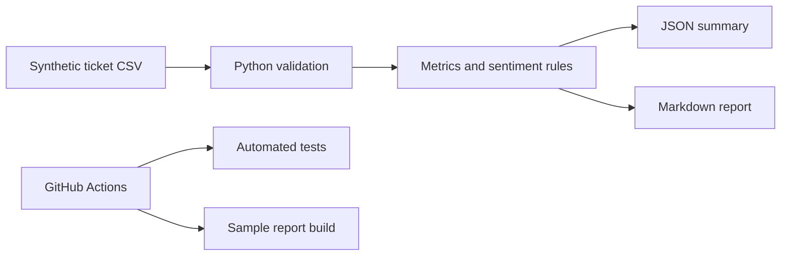

# Customer Support Insights

A beginner-friendly, end-to-end Python portfolio project that turns synthetic customer-support tickets into useful operational insights.

> This project uses only synthetic, non-confidential data. It contains no Microsoft or customer data, code, prompts, or artifacts.

## Why this project matters

It demonstrates practical skills that recruiters can inspect:

- Python and clean functions
- CSV ingestion and validation
- Basic analytics and business metrics
- Transparent keyword-based sentiment classification
- Markdown and JSON report generation
- Unit testing
- GitHub Actions continuous integration
- Documentation and responsible data handling

## Architecture



## Quick start

Requires Python 3.10 or later. No third-party packages are required.

```bash
python src/analyze_tickets.py
```

Outputs:

- `output/summary.json`
- `output/report.md`

Run tests:

```bash
python -m unittest discover -s tests -p "test_*.py"
```

## Sample insights

Using the included synthetic dataset, the project calculates:

- ticket volume by category and priority
- open versus resolved ticket counts
- average resolution hours
- SLA breach count and rate
- simple positive, neutral, and negative keyword sentiment

## Repository structure

```text
customer-support-insights/
├── .github/workflows/ci.yml
├── data/sample_tickets.csv
├── output/
├── src/analyze_tickets.py
├── tests/test_analyze_tickets.py
├── CONTRIBUTING.md
├── LICENSE
└── README.md
```

## Suggested next improvements

- Add charts with Power BI or Python
- Replace keyword sentiment with an ML model
- Store results in SQLite
- Add a small Streamlit dashboard
- Add Docker support
- Add anonymization checks for uploaded datasets

## Responsible-use statement

The included dataset is entirely synthetic. Do not upload employer, customer, confidential, personal, or proprietary data to a public repository.

## Author

Bishal Rath

Data Engineering and AI enthusiast building practical, responsible solutions.
